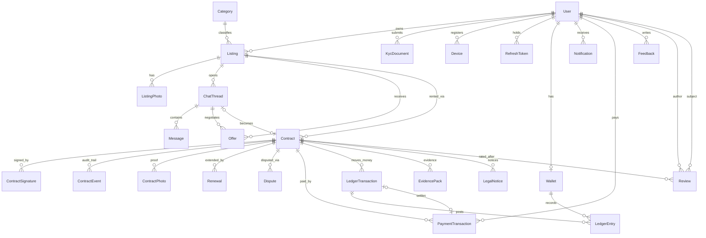

# Borrow Circle — Data model (ER diagram)

Source of truth: [`server/prisma/schema.prisma`](../server/prisma/schema.prisma).
This diagram shows the main relationships; supporting tables (Device, RefreshToken,
ContractVersion, LegalNotice, EvidencePack, Block, Report, AdminAction, Setting) are
listed at the end.



## Key modelling decisions

| Concern | Decision |
| --- | --- |
| Money | Integer **paise** everywhere (`rentTotalPaise`, `depositPaise`, …). No floats. |
| Wallet | `LedgerTransaction` + `LedgerEntry` double-entry; `Wallet.availablePaise` / `heldPaise` are cached projections. |
| Deposits | Held in `USER_HELD`, not spendable; released to `USER_AVAILABLE` or forfeited to the lender's available balance. |
| Location | `Listing.location` is PostGIS `geography(Point,4326)`; latitude/longitude kept for simple map rendering. GiST index in `server/prisma/sql/postgis.sql`. |
| KYC | Full Aadhaar never stored. `numberLast4` + HMAC `numberHash` + provider reference only. Images in encrypted private storage. |
| Contracts | Versioned (`ContractVersion` + `Contract.version`); signatures and every state change are separate append-only rows. |
| Chat | One thread per (listing, borrower); a thread can produce at most one contract. |
| Reviews | One review per author per contract: `@@unique([contractId, authorId])`, rating 1–5 enforced in the service layer. |
| Admin | `AdminAction` = who did what; `AuditLog` = hash-chained, append-only security log. |

## Contract state machine

```
DRAFT → PENDING_SIGNATURES → ACTIVE → (RENEWED → ACTIVE)
                                   ↓
                    OVERDUE → NOTICE_SENT → RECOVERY → LEGAL_ESCALATED → CLOSED
                                   ↓
                              DISPUTED → CLOSED
ACTIVE/PENDING → CANCELLED
ACTIVE (return confirmed) → COMPLETED
```

`RENEWED` is a momentary marker written when an extension is approved; the contract
returns to `ACTIVE` with the new `rentalEndDate`, and a `Renewal` row plus a
`ContractVersion` snapshot preserve the history.

## Supporting tables

- **Device / RefreshToken** — device binding, rotating refresh tokens, reuse detection.
- **ContractVersion** — immutable term snapshots (hash + JSON) for re-signing.
- **EvidencePack / LegalNotice** — Phase 13 evidence generator and notice ladder.
- **Block / Report** — user safety controls.
- **AdminAction / Setting / AuditLog** — admin ops, configurable fees, tamper-evident audit.
- **BlacklistEntry** — phone/Aadhaar/PAN hash and device-level bans.
